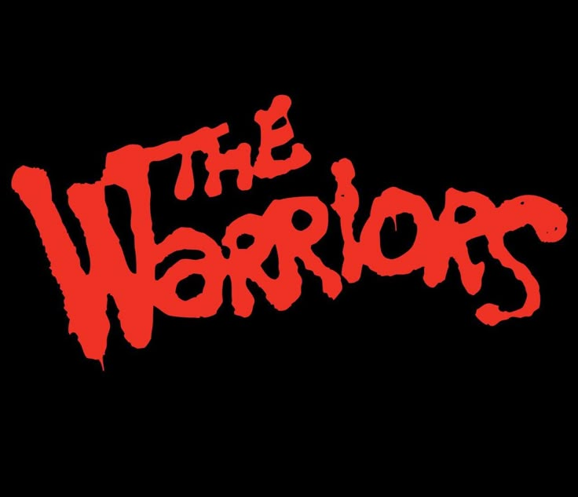

<p align="center">
  
</p>

Unofficial native PC bring-up of **The Warriors** (original Xbox), **European** multi-language disc (`En,Fr,De,Es,It`), built with the [Xbox XBE Recomp](https://github.com/TGP482/XboxXBERecomp) toolchain.

This is a **static recompilation**, not an emulator. The x86 code inside your `default.xbe` is translated ahead of time to C++ and linked against the host runtime (D3D12, XAudio2, input, filesystem).

> **Bring your own dump.** This repository does **not** ship game files, ISOs, or XBEs. You need a legally owned original Xbox copy of The Warriors (Europe).

**Author:** [Matt-code-d](https://github.com/Matt-code-d) (Matteo Santoro)

Title ID: `5454009B` · EUR `default.xbe` SHA1: `1126266F440762D00303760C23990C3278025797`

---

## Status

Boots on Windows (Release) with a WPF launcher for ISO install, language selection (`XC_LANGUAGE`), and graphics settings written to `settings.toml`.

Still early (alpha): expect graphics quirks (e.g. some light coronas), incomplete audio polish, and the usual bring-up rough edges. See [warriors-recomp/PROGRESS.md](warriors-recomp/PROGRESS.md).

This tree targets the **EUR** disc (PAL movies under `bik_pal`, five language packs on one image).

---

## License (read this)

See **[LICENSE](LICENSE)**.

- **MIT** covers **only** original work in this repository (launcher, EUR host patches, docs, configs authored here).
- It does **not** grant rights to **The Warriors** game data (ISO / XBE / WAD / Bink / audio). Those stay with Rockstar / Take-Two / related rights holders.
- Third-party SDKs and tools (XboxXBERecomp, LLVM, SDL, ImGui, extract-xiso, …) keep **their own** licenses.
- **No game data in git. No reuploads.** Supply your own legally obtained dump locally.

---

## Quick start (launcher)

1. Install the [.NET 8 Desktop Runtime](https://dotnet.microsoft.com/download/dotnet/8.0).
2. Build once (below) **or** use a Release folder that already contains `Warriors.exe` + `WarriorsLauncher.exe`.
3. Put [extract-xiso](https://github.com/XboxDev/extract-xiso) at `tools/extract-xiso/artifacts/extract-xiso.exe` if you want extract mode.
4. Run the launcher **from the EUR build output**:

```powershell
.\warriors-recomp\out\build\release\WarriorsLauncher.exe
```

In the launcher:

1. **SETUP / ISO** → pick your EUR `.iso` → **INSTALL INTO ASSETS**
2. **LANGUAGE** → packs listed from that disc name (e.g. `En,Fr,De,Es,It`); selection is written for the host before **PLAY**
3. **GRAPHICS** → FPS, resolution, display mode, D3D12 (Vulkan reserved / not built yet)
4. **PLAY**

Launcher settings: `%USERPROFILE%\Documents\thewarriors\launcher_settings.json`  
Host settings beside the exe: `settings.toml`, `language.cfg`  
Logs: `logs\warriors.log`

---

## Language (EUR)

The Europe disc carries **five** UI/audio packs. On hardware the dashboard **XC_LANGUAGE** selects which one runs:

| Id | Language |
|----|----------|
| 1 | English |
| 3 | Deutsch |
| 4 | Français |
| 5 | Español |
| 6 | Italiano |

The launcher writes:

- `language.cfg` (single integer) beside `Warriors.exe`
- env `XBE_LANGUAGE` / `XC_LANGUAGE` when starting the process
- `[warriors_launcher].language` inside `settings.toml`

The EUR host reads those in order and logs `XC_LANGUAGE=…` at boot. Change language in the launcher, then **PLAY** (restart if the game was already open).

ISO names are parsed from **parenthetical token lists** only (e.g. `(En,Fr,De,Es,It)`), so `Europe` is not mistaken for English. If the name has no language list but says Europe/PAL/EUR, all five packs are offered.

---

## Game data layout

After install (gitignored — never commit this):

```
warriors-recomp/out/build/release/assets/   (or the Assets path shown in the launcher)
  default.xbe
  audio/
  bik_pal/          (+ optional bik junction / NTSC-named hardlinks)
  Main.wad*
  Paks.wad*
  System.wad0
  XBoxWad.idx
```

Movies on EUR are `bik_pal\*_pal.bik`. Re-run `tools\alias_eur_movies.ps1` after a fresh extract if you need NTSC-style movie aliases.

---

## Build from source

### Prerequisites

- Windows 10/11 x64  
- Visual Studio 2022 Build Tools with **Clang** + CMake + Ninja  
- GPU with Direct3D 12  

### Host + game code

```powershell
cd warriors-recomp
# first time: build.bat  (symbols + full recomp — can take a long time)
# incremental host / hooks:
..\tools\rebuild_host.bat
```

`rebuild_host.bat` builds `Warriors.exe` / `Warriors.dll`, publishes `WarriorsLauncher.exe` next to them, and copies the launcher into `..\port\` when that folder exists.

**Important:** the first PLAY builds `Warriors.dll` from your `default.xbe` (one-time, a few minutes). After that it should **not** rebuild every launch. It only rebuilds if the XBE changes or `Warriors.exe` is replaced (host rebuild). `tools\rebuild_host.bat` refreshes `compiler\work\Warriors\built.txt` so a host rebuild does not force another full game-code compile.

### Launcher only

```powershell
dotnet build warriors-recomp\launcher\WarriorsLauncher.csproj -c Release -o warriors-recomp\out\build\release
```

---

## Known issues

- Some light coronas / flares may look blocky; 720p video flags and DrawIndexedVerticesUP hooks are in progress.
- Stock Bink symbols are not hooked (EUR BINK is in-image); movies use guest Bink.
- Vulkan is **not** implemented in this SDK — launcher option is reserved.

---

## Roadmap

Planned (not in this alpha yet):

- **Mouse + keyboard** — full playability with KBM (camera, combat, menus, minigames), with a launcher toggle to enable/disable alongside gamepad.
- **Online co-op multiplayer** — networked co-op mode (session join/host from the launcher or in-game flow). Details and scope TBD as the single-player bring-up stabilizes.

---

## Credits

- [TGP482/XboxXBERecomp](https://github.com/TGP482/XboxXBERecomp) — recompiler / runtime SDK  

Some bring-up steps (function-boundary hunting, launcher wiring, crash triage) used **AI assistance** as a tool alongside manual reverse-engineering and testing. The runtime, game dump handling, and final decisions stay human-owned.

Game © Rockstar / Take-Two. This project is unofficial and unaffiliated.
